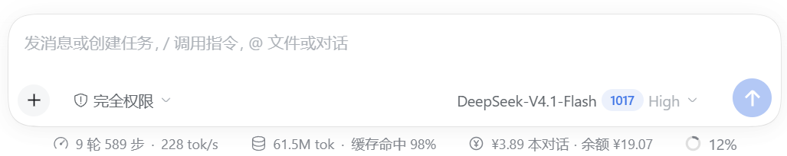
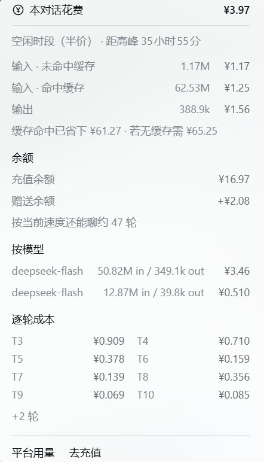

# Spend Meter (spend-meter)

[简体中文](README.md) | **English**

A permanent line under the composer — `¥3.89 this chat · balance ¥19.07` — that opens the ledger for the current conversation when clicked.



Click it and this is the bill:



The styling deliberately follows two pieces of DSH's own UI: the pill copies `StatsPills` (the same bare-text buttons as `3 turns 228 steps · 232 tok/s` and `20.9M tok · 96% cached`), and the popover copies `stat-dialog` (the background, radius, shadow, rules and right-aligned tabular numbers of the "Token usage" card). Every design token comes from the runtime `--dsw-*` / `--dsh-*` variables, so light and dark themes follow automatically.

## Install

Requires DSH 0.2.1-rc.5 or newer on desktop (the plugin registers as a bundle in the profile).

1. Put the whole directory anywhere, for example `%USERPROFILE%\.dsh\plugins\spend-meter`.
2. Ask the agent in DSH to run `plugin_manager`'s `install_bundle` with `target` set to the **absolute path** of that directory; the plugin manager lists it as "Spend Meter".
3. When `¥0.00 this chat · balance ¥0.00` appears under the composer, it is installed.

The package name is fixed to `@local/spend-meter` (the local-package convention); nothing is published to npm.

## What it shows

| Where | Contents |
| --- | --- |
| The pill | Cost of this conversation, platform balance (yellow below ¥5, red below ¥1); the ¥ icon turns yellow during peak hours and stays grey off-peak |
| Ledger · time | Whether it is peak right now, and how long until the next half-price / peak window |
| Ledger · cost | Uncached input, cached input, output, web search, auto-compaction summaries — each with its amount and token count |
| Ledger · cache | Money saved by cache hits, and what the same tokens would have cost without a cache |
| Ledger · balance | Top-up balance + bonus balance, and roughly how many more turns it can pay for at the current pace |
| Ledger · budget | Today / this month spent vs. limit (only with `budget` configured), yellow at 80%, red with a notice once exceeded |
| Ledger · models | Cost split per model (shown only when a session used more than one) |
| Ledger · turns | The cost of each of the last 8 turns, expandable to the whole conversation |
| Ledger · links | Jump to the DeepSeek platform's usage / top-up pages |

## Where the numbers come from

**Cost**: the Host half registers a session projection named `spendMeter` that only folds the session event log, so it survives restarts and session switches:

- `usage` on `assistant/message` / `assistant/attempt` → bucketed by `(turn, step)`; a retry subtracts the previous sample before adding the new one, so nothing is charged twice.
- `usage` on `compaction/summary` → reported separately as the hidden cost of auto-compaction.
- `web_search` / `web_fetch` in `tool/call` → priced per call (¥0.005 by default, charged from 2026-11-01).
- Prices are picked by **each event's own timestamp**: peak is Monday–Friday 09:00–12:00 and 14:00–18:00 Beijing time, everything else is half price.

**Balance**: the Client half calls the `account` Remote directly (`ctx.remote.account.getBalance(...)`, the same path as Settings → Account), refreshing every 15 seconds, and immediately when the window becomes visible or the ledger is opened.

The projection view still carries a `wallet` field as a fallback while the Remote has not answered. It cannot be the only source: a projection only recomputes and broadcasts when a **session event** replaces its state reference, while wallet polling produces neither an event nor a state change — after a cold start the page would sit on the `loading` snapshot captured in the baseline forever.

That call is **not declared in `inject`**; it is resolved at runtime through `ctx.get`. Cordis has no optional injection, so hard-injecting a service that is not mounted yet leaves the entry `pending`, and the desktop web boot treats "any entry not active" as a fatal error.

**Budget**: the projection state carries a `days` map bucketed by Beijing date; every event adds only its **cost delta** to that event's own day (a retry that replaces an attempt subtracts, so nothing is double counted). The Host half then sums those buckets across sessions into today / this month:

- Persisted file: `spend-meter-ledger.json` in `%DSH_PROFILE_DIR%` (last 70 days kept), so restarts continue where the last run stopped.
- Merge order: on-disk ledger → sessions seen by this process (`sessionProjections.onChanged` pushes absolute maps) → the current session's own `days` (applied last, so the newest event is never missing).
- Without `budget` configured the field is absent and the popover shows no budget section.

## Robustness

The Client half never throws into Cordis (otherwise the whole app would refuse to start):

- every step of `apply` (dictionaries, styles, mounting) is wrapped in `guard()`, and a failure only lands in `problems`;
- `buildPanel()` is try/catch as a whole and degrades the pill to `—`, while `PanelBoundary` catches the popover;
- styles are always CSS classes, never a string handed to `style` (React requires an object there; a string throws during render and the slot runtime silently drops the whole cell).

Anything the plugin diagnoses about itself is shown in the "Plugin problem" block at the bottom of the popover.

## Pricing (built-in defaults, overridable through `config` in the patch)

| Model | Cache hit | Cache miss | Output |
| --- | --- | --- | --- |
| deepseek-flash (including the v4-flash aliases) | ¥0.04 / ¥0.02 | ¥2 / ¥1 | ¥8 / ¥4 |
| deepseek-v4-pro | ¥0.30 / ¥0.15 | ¥9 / ¥4.5 | ¥27 / ¥13.5 |

Units: CNY per million tokens, formatted as "peak / off-peak". Models outside the table are collected into `unpriced` and excluded from the totals.

## Configuration example

Add a `config` block to the `spend-meter` row in the profile's `cordis.patch.yml` (`%USERPROFILE%\.dsh\profiles\<profile>\`):

```yaml
- id: spend-meter
  config:
    holidays: ['2026-10-01', '2026-10-02']   # public holidays are priced off-peak all day
    searchPerCall: 0.005
    turnHistory: 120
    currency: CNY
    budget:
      daily: 20            # today's limit, same unit as currency; omit or 0 for no limit
      monthly: 200         # this month's limit
      warnRatio: 0.8       # turns yellow at this share, red with a notice past 100%
    models:
      deepseek-flash:
        peak: { cacheHit: 0.04, cacheMiss: 2, output: 8 }
        offPeak: { cacheHit: 0.02, cacheMiss: 1, output: 4 }
```

> The plugin declares no `Config`, so `config` is not schema-validated; every field falls back to the table above.

## Files

| File | Purpose |
| --- | --- |
| `index.js` | Host half: the `spendMeter` projection (cost ledger + day buckets), the cross-session ledger, and the wallet fallback poll |
| `client.ui.js` | Client half source (pill, popover, CSS, dictionaries) |
| `client.js` | Deployment artifact, identical to `client.ui.js` |
| `locale/{en,zh}.json` | Title and description shown in the plugin manager |
| `icon.svg` | Plugin icon |
| `cordis.patch.yml` | Bundle insert declaration |
| `README.md` / `README.en.md` | Chinese / English documentation |
| `docs/preview.png` | Screenshot of the pill |
| `docs/panel.png` | Screenshot of the ledger popover |

After editing the source: `Copy-Item client.ui.js client.js -Force`. DSH's client-module HMR picks it up in about 3–4 seconds; no page refresh is needed.

## Known limits

- **The price table is built in** (DeepSeek's official prices as fetched in 2026-10). After an official price change, edit `DEFAULT_PRICING` in `index.js` or override it through the profile patch's `config`; models outside the table only count tokens, never money, and are flagged at the bottom of the popover.
- **Search billing** starts at 2026-11-01 00:00 Beijing time, per the official announcement; earlier `web_search` / `web_fetch` calls are counted as free.
- **The balance needs a platform account**: when DSH uses an API key and is not signed in to a DeepSeek platform account, the wallet cannot be read — the balance slot shows `—`, the popover explains why, and cost tracking is unaffected.
- **This conversation only**: for a cross-session total, use the platform usage page (linked at the bottom of the popover).
- **Budgets count from the day the plugin started bookkeeping**: the ledger only accumulates events this plugin saw, so spending from before installation is missing and the first "this month" figure reads low. The popover says "Counting since <date>" so you know; that line disappears once the date falls into a previous month.
- The "roughly N more turns" figure extrapolates from this session's average cost per turn, so it drifts in long conversations.
