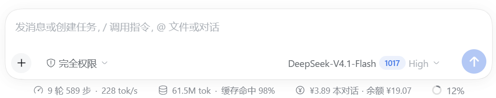
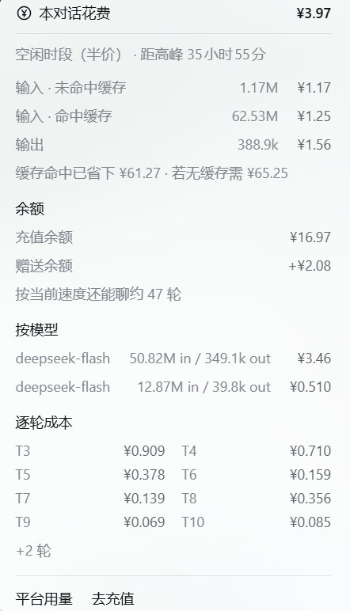

# 花费与余额（spend-meter）

**简体中文** | [English](README.en.md)

在输入框下方常驻一条 `¥3.89 本对话 · 余额 ¥19.07`，点开是本对话账本。



点开之后是这笔账：



样式刻意贴合 DSH 自带的两处 UI：药丸照 `StatsPills`（`3 轮 228 步 · 232 tok/s`、`20.9M tok · 缓存命中 96%` 同款裸文字按钮），弹层照 `stat-dialog`（「Token 用量」那张卡片的背景、圆角、阴影、分隔线、右对齐等宽数字）。全部设计令牌取自运行时的 `--dsw-*` / `--dsh-*` 变量，浅色/深色主题自动跟随。

## 安装

需要 DSH 0.2.1-rc.5 及以上的桌面端（插件以 bundle 形式注册到 profile）。

1. 把整个目录放到任意位置，例如 `%USERPROFILE%\.dsh\plugins\spend-meter`。
2. 在 DSH 里让 Agent 执行 `plugin_manager` 的 `install_bundle`，`target` 填该目录的**绝对路径**；插件管理器里也会显示为「花费与余额」。
3. 输入框下方出现 `¥0.00 本对话 · 余额 ¥0.00` 即安装成功。

包名固定为 `@local/spend-meter`（本地包惯例），无需发布到 npm。

## 显示什么

| 位置 | 内容 |
| --- | --- |
| 常驻药丸 | 本对话花费、平台余额（低于 ¥5 变黄、低于 ¥1 变红）；高峰时段 ¥ 图标变黄，空闲时段保持灰色 |
| 账本 · 时段 | 现在是否高峰，以及距下一个半价/高峰时段还有多久 |
| 账本 · 花费 | 输入未命中缓存、输入命中缓存、输出、联网搜索、自动压缩摘要，各自金额与 token 数 |
| 账本 · 缓存 | 缓存命中省下的钱，以及「如果没有缓存本来要花多少」 |
| 账本 · 余额 | 充值余额 + 赠送余额，以及「按当前速度还能聊约 N 轮」 |
| 账本 · 预算 | 今日 / 本月已花与上限（配置了 `budget` 才显示），达到 80% 变黄、超支变红并给出提示；届时输入框上方的金额也会跟着变色，悬停可看到今日百分比 |
| 账本 · 模型 | 按模型拆分的金额（多模型会话才显示） |
| 账本 · 逐轮 | 最近 8 轮各自的成本，点「展开更早 N 轮」可看到全部 |
| 账本 · 链接 | 跳转 DeepSeek 平台「查看用量 / 去充值」 |

## 数据从哪来

**花费**：Host 半注册一个 session 投影 `spendMeter`，只读会话事件流，因此重启、切会话都不丢：

- `assistant/message` / `assistant/attempt` 的 `usage` → 按 `(turn, step)` 归户；重试会先扣掉旧样本再计新的，不会重复计费。
- `compaction/summary` 的 `usage` → 单列为「自动压缩摘要」的隐藏成本。
- `tool/call` 里 `web_search` / `web_fetch` → 按次计价（默认 ¥0.005/次，2026-11-01 起收费）。
- 价格按**每条事件自己的时间戳**判断高峰/空闲：北京时间周一至周五 9:00–12:00、14:00–18:00 为高峰，其余为半价。

**余额**：由 Client 半直接调 `account` Remote（`ctx.remote.account.getBalance(...)`，和「设置 → 账户」走同一条路），每 15 秒刷新一次，窗口重新可见或点开账本时也会立刻刷新。

投影视图里的 `wallet` 字段仍然保留，作为 Remote 尚未返回时的兜底值。之所以不能只靠投影：投影只在**会话事件**让状态换新引用时才重算并广播，钱包轮询既不产生事件、也不改状态，冷启动后页面会一直停在 baseline 抓到的那份 `loading` 上。

余额这条调用**不写进 `inject`**，而是运行时用 `ctx.get` 解析：Cordis 没有 optional 注入，硬 inject 一个尚未挂载的服务会让条目 pending，而桌面端 web boot 把「任一条目没激活」视为致命错误。

**预算**：投影状态里带一个按北京时间日期分桶的 `days` 映射，每次事件只把**金额增量**记到该事件自己那一天的桶里（重试替换产生的负增量会自动抵扣）。Host 半再把各会话的桶汇总成今日/本月：

- 落盘文件：`%USERPROFILE%\.dsh\spend-meter-ledger.json`（设了 `DSH_PROFILE_DIR` 时放在该目录下，也可用环境变量 `SPEND_METER_LEDGER` 直接指定路径；保留最近 70 天），重启后接着算。
- 汇总顺序：磁盘台账 → 本次运行里见过的会话（`sessionProjections.onChanged` 推送的绝对值）→ 当前会话自己的 `days`（最后覆盖，避免「最后一个事件还没广播」的滞后）。
- 没有配置 `budget` 时不产生这个字段，弹层里也就不显示预算小节。

## 稳健性

客户端半分不会把异常抛给 Cordis（否则整个应用起不来）：

- `apply` 里的每一步（字典、样式、挂载）都用 `guard()` 包住，失败只记进 `problems`。
- `buildPanel()` 整体 try/catch，失败时药丸降级为 `—`，弹层由 `PanelBoundary` 兜住。
- 样式一律用 CSS 类，不传字符串给 `style`（React 要求对象，传错会在渲染期抛错并被 slot 运行时静默移除整个 cell）。

排障时插件自己的诊断写在浮层底部的「插件异常」块里。

## 价目（内置默认值，可在 patch 的 `config` 覆盖）

| 模型 | 缓存命中 | 缓存未命中 | 输出 |
| --- | --- | --- | --- |
| deepseek-flash（含 v4-flash 别名） | ¥0.04 / ¥0.02 | ¥2 / ¥1 | ¥8 / ¥4 |
| deepseek-v4-pro | ¥0.30 / ¥0.15 | ¥9 / ¥4.5 | ¥27 / ¥13.5 |

单位：元 / 百万 tokens，格式为「高峰 / 空闲」。查表顺序是：先精确匹配模型名，再抹掉日期/版本尾巴（如 `-1017`、`-20250929`）匹配，最后才按名字族回退——名字里带 `deepseek` 且含 `flash` 按 flash 价、含 `pro` 按 pro 价。走到第三级时弹层会注明「按模型族近似计价：<模型>」。其余模型计入 `unpriced`，不参与金额合计。

`config.models` 里既可以用上面的 `peak` / `offPeak` 写法，也可以用**平价写法**（一个价全天生效，适合不区分时段的第三方渠道）：

```yaml
    models:
      deepseek-v4.1-flash-1017: { cacheHit: 0.02, cacheMiss: 1, output: 4 }   # 平价，峰谷同价
```

## 计费口径

分子分项全部来自 DSH 记录的 usage 事件，不额外请求平台账单：

| 分项 | 取自 | 说明 |
| --- | --- | --- |
| 未命中输入 | `usage.inputTokens` | 真实日志里满足 `totalTokens = inputTokens + outputTokens + cacheReadTokens`，所以这是**未命中**部分，不会是全量 prompt |
| 命中输入 | `usage.cacheReadTokens` | 按命中价计；同时算出「缓存省下」= 这部分若按未命中价要花多少 |
| 输出 | `usage.outputTokens` | 推理模型把思考计入输出，就一并按输出价算；usage 里没有独立的 reasoning 字段可拆 |
| 缓存写入 | `usage.cacheWriteTokens` | 实测所有事件恒为 0（DeepSeek 不单独报缓存创建），若某个 provider 报了，按未命中价计 |

只有**成功返回**的 `assistant/message` 带 usage。失败的请求（例如 401）落在 `assistant/attempt` 上，usage 全 0，因此**不计费**——这一点与实际账单一致。同一 `turn/step` 重复上报时会用后一次替换前一次（重试不重复计费）。

联网搜索按次计费（默认 ¥0.005/次，`searchFreeUntil` 之前免费），自动压缩摘要的 LLM 花费单列为「压缩摘要」。

## 配置示例

在 profile 的 `cordis.patch.yml`（`%USERPROFILE%\.dsh\profiles\<profile>\`）里给 `spend-meter` 行加 `config`：

```yaml
- id: spend-meter
  config:
    holidays: ['2026-10-01', '2026-10-02']   # 法定节假日全天按空闲价
    searchPerCall: 0.005
    turnHistory: 120
    currency: CNY
    budget:
      daily: 20            # 今日上限，单位同 currency；不配或填 0 表示不限
      monthly: 200         # 本月上限
      warnRatio: 0.8       # 到这个比例变黄，超过 100% 变红并提示
    models:
      deepseek-flash:
        peak: { cacheHit: 0.04, cacheMiss: 2, output: 8 }
        offPeak: { cacheHit: 0.02, cacheMiss: 1, output: 4 }
```

> 本插件不声明 `Config`，`config` 不做 schema 校验，字段全部按上表兜底。

## 文件

| 文件 | 作用 |
| --- | --- |
| `index.js` | Host 半：投影 `spendMeter`（花费账本 + 日桶）+ 跨会话台账 + 钱包兜底轮询 |
| `client.ui.js` | Client 半源文件（药丸、弹层、CSS、字典） |
| `client.js` | 部署产物，内容与 `client.ui.js` 相同 |
| `locale/{en,zh}.json` | 插件管理器里显示的标题与说明 |
| `icon.svg` | 插件图标 |
| `cordis.patch.yml` | bundle 插入声明 |
| `README.md` / `README.en.md` | 中文 / 英文文档 |
| `docs/preview.png` | 药丸截图 |
| `docs/panel.png` | 账本弹层截图 |

改完源码后：`Copy-Item client.ui.js client.js -Force`，DSH 的客户端模块 HMR 大约 3–4 秒生效，不需要刷新页面。

## 已知限制

- **价格表是内置的**（2026-10 抓取的 DeepSeek 官方价）。官方调价后需要改 `index.js` 里的 `DEFAULT_PRICING`，或在 profile patch 的 `config` 里覆盖；不在表内的模型只统计 token，不计金额，并在弹层底部提示。
- **搜索计费**按官方公告从北京时间 2026-11-01 00:00 起算，之前的 `web_search` / `web_fetch` 记为免费。
- **余额依赖平台账户**：DSH 用 API Key 且未登录 DeepSeek 平台账号时读不到钱包，此时余额位显示 `—`，弹层里给出原因，花费统计不受影响。
- **只统计本会话**：跨会话累计请用平台用量页（弹层底部有入口）。
- **预算从插件开始记账那天算起**：台账只累加本插件看到的事件，装插件之前的历史消费不在其中，所以第一个月的「本月」会偏低；弹层里会用「自 <日期> 起统计」标出来，该日期进入下一个月后就不再显示。
- 账本里的「还能聊约 N 轮」是本会话平均每轮成本外推，长会话里偏差会变大。
